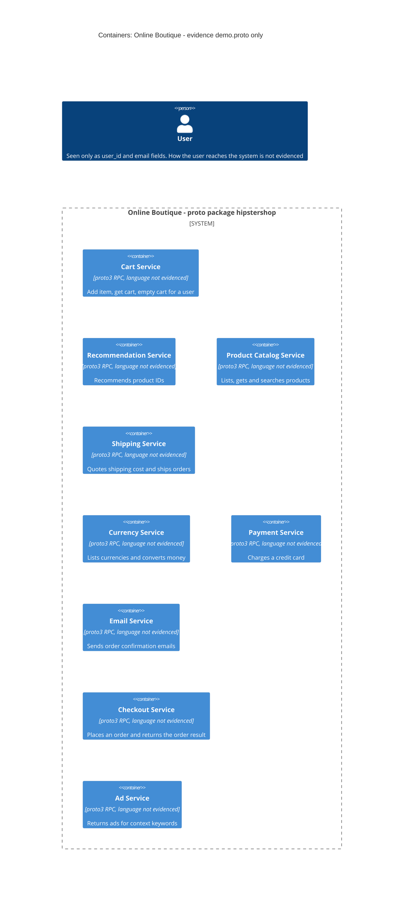

# Task 1A: Recovered architecture (C4 container level)

Evidence allowed for this run: `system/online-boutique/protos/demo.proto` only.

## 1. Agent

- Product: **Claude Code**, running as a sub-agent session
- Model: **Claude Opus 5.5** (`claude-opus-5-5`)

## 2. Files read

1. `prompts/1-recover-architecture.md` (the task file)
2. `system/online-boutique/protos/demo.proto` (the evidence)

No other files were opened.

## 3. Containers table

All nine containers come from the `service` blocks in the proto file (`syntax = "proto3"`, line 15; `package hipstershop`, line 17). The file only defines interfaces. It does not show the implementation language, the runtime, or whether each service is deployed separately (see Gaps).

| # | Container | Technology / language | Responsibility (from its RPCs) | Evidence |
|---|---|---|---|---|
| 1 | Cart Service | proto3 RPC interface. Language not evidenced | Adds an item to a user's cart, returns the cart, empties the cart (`AddItem`, `GetCart`, `EmptyCart`) | `system/online-boutique/protos/demo.proto` lines 23-27 (`service CartService`), lines 47-50 (`message Cart`) |
| 2 | Recommendation Service | proto3 RPC interface. Language not evidenced | Returns recommended product IDs for a user and a list of product IDs (`ListRecommendations`) | `system/online-boutique/protos/demo.proto` lines 56-67 (`service RecommendationService`, request/response) |
| 3 | Product Catalog Service | proto3 RPC interface. Language not evidenced | Lists, gets and searches products (id, name, description, picture, `price_usd`, categories) (`ListProducts`, `GetProduct`, `SearchProducts`) | `system/online-boutique/protos/demo.proto` lines 71-75 (`service ProductCatalogService`), lines 77-87 (`message Product`) |
| 4 | Shipping Service | proto3 RPC interface. Language not evidenced | Quotes a shipping cost for an address and items, ships an order and returns a tracking ID (`GetQuote`, `ShipOrder`) | `system/online-boutique/protos/demo.proto` lines 107-110 (`service ShippingService`), lines 117-128 |
| 5 | Currency Service | proto3 RPC interface. Language not evidenced | Lists supported ISO 4217 currency codes and converts a `Money` amount to another currency (`GetSupportedCurrencies`, `Convert`) | `system/online-boutique/protos/demo.proto` lines 140-143 (`service CurrencyService`), lines 146-173 |
| 6 | Payment Service | proto3 RPC interface. Language not evidenced | Charges an amount to a credit card and returns a transaction ID (`Charge`) | `system/online-boutique/protos/demo.proto` lines 177-179 (`service PaymentService`), lines 181-195 |
| 7 | Email Service | proto3 RPC interface. Language not evidenced | Sends an order confirmation for an `OrderResult` to an email address (`SendOrderConfirmation`) | `system/online-boutique/protos/demo.proto` lines 199-201 (`service EmailService`), lines 208-219 |
| 8 | Checkout Service | proto3 RPC interface. Language not evidenced | Places an order from user ID, currency, address, email and credit card, and returns an `OrderResult` with order ID, tracking ID, shipping cost and items (`PlaceOrder`) | `system/online-boutique/protos/demo.proto` lines 224-239 (`service CheckoutService`, `PlaceOrderRequest`, `PlaceOrderResponse`) |
| 9 | Ad Service | proto3 RPC interface. Language not evidenced | Returns ads (redirect URL and text) for page context keywords (`GetAds`) | `system/online-boutique/protos/demo.proto` lines 243-262 (`service AdService`, `AdRequest`, `Ad`) |

- **Data stores:** Not evidenced in the provided files. The proto has no database, cache or storage definitions.
- **Message brokers:** Not evidenced in the provided files. All 15 RPCs are unary request/response (there is no `stream` keyword anywhere in the file).
- **End user (diagram `Person`, not a container):** the file shows only that a user exists as data: `user_id` (lines 35, 40, 44, 48, 61, 229) and `email` (lines 217, 233). It does not show how the user reaches the system.

## 4. Dependencies table

| Caller → callee | Protocol | Evidence |
|---|---|---|
| None evidenced | n/a | `system/online-boutique/protos/demo.proto` declares only each service's own server interface (`service` / `rpc` blocks). It contains no client calls, service addresses or environment variables, so it cannot show which container calls which. |

Possible dependencies suggested by shared message types are listed under **Gaps** as **[Inferred]**. They are not in the diagram.

## 5. Mermaid diagram

There is no `Rel` because the Dependencies table has no evidenced dependencies. There are no `ContainerDb`, `ContainerQueue` or `System_Ext` elements because none are evidenced.

## 6. Gaps

| Gap | What the proto does / does not show | File that would settle it |
|---|---|---|
| Caller → callee dependencies | None shown. **[Inferred]** candidates from shared message types: **Checkout → Payment** (`PlaceOrderRequest.credit_card` and `ChargeRequest.credit_card` are both `CreditCardInfo`, lines 190, 234). **Checkout → Shipping** (`Address` in lines 113, 122, 232; `OrderResult.shipping_tracking_id` / `shipping_cost`, lines 210-211, match `ShipOrderResponse.tracking_id` / `GetQuoteResponse.cost_usd`, lines 118, 127). **Checkout → Email** (`OrderResult` is both the `PlaceOrderResponse` and the `SendOrderConfirmationRequest.order` payload, lines 218, 238). **Checkout → Cart** (`PlaceOrderRequest` has `user_id` but no items, lines 228-235, so items probably come from `GetCart(user_id)`). **Checkout → Currency** (`user_currency`, line 230, vs `Convert`, line 142). **Checkout → Product Catalog** (per-item `OrderItem.cost`, line 205, vs `Product.price_usd`, line 82). | Each service's source code (its location is not visible from this evidence) and the deployment manifests in `system/online-boutique/kubernetes-manifests/`, specifically each Deployment's `*_SERVICE_ADDR` environment variables |
| Front end / web UI and how the user reaches the system | No proto `service` for a UI. Something must call Cart, Catalog, Recommendation, Ad, Currency and Checkout for a user, but the caller is not shown. (AGENTS.md's example cites `kubernetes-manifests/frontend.yaml`. That is a hint, not evidence for this run, so no frontend container was added.) | `system/online-boutique/kubernetes-manifests/frontend.yaml` and the frontend source code |
| Transport protocol | The `service` / `rpc` definitions are a Protocol Buffers RPC interface. The file never names the transport. **[Inferred]** gRPC. Ports and TLS are not evidenced. | Deployment manifests (container ports) or service source code (server setup) |
| Implementation language per service | Not evidenced. `option go_package` (line 19) shows only that Go bindings are generated from this proto. It does not say which services are written in Go. | Each service's source code or Dockerfile |
| One container per service? | Each `service` was treated as one container **[Inferred]**. The file does not show whether they run as separate processes or deployments. | `system/online-boutique/kubernetes-manifests/` (one Deployment per service?) |
| Data stores | Not evidenced. Cart Service keeps per-user cart state (`Cart`, lines 47-50), but where it is stored is not shown. Where the Product Catalog gets its data is not shown either. | `system/online-boutique/kubernetes-manifests/` (for example, a database or cache Deployment and the cart service's address environment variable) and the cart / catalog source code |
| External systems | Not evidenced. It is not shown whether Payment calls a real card processor, Email uses an external mail provider, Shipping uses a carrier, or Currency fetches exchange rates externally. | Payment, email, shipping and currency service source code and configuration |
