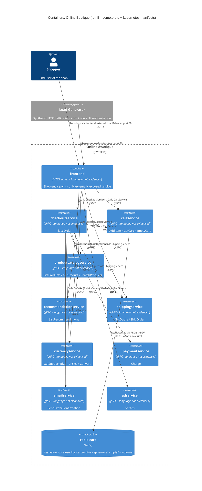

# Task 1B: Recovered C4 container architecture of Online Boutique

- **Run:** B
- **Evidence allowed:** `system/online-boutique/protos/demo.proto`, `system/online-boutique/kubernetes-manifests/`

## 1. Agent

- **Product:** Claude Code (Anthropic), running as a sub-agent session.
- **Model:** Claude Opus 5.5 (model ID `claude-opus-5-5`).

## 2. Files read

1. `prompts/1-recover-architecture.md` (task file)
2. `system/online-boutique/protos/demo.proto`
3. `system/online-boutique/kubernetes-manifests/adservice.yaml`
4. `system/online-boutique/kubernetes-manifests/cartservice.yaml`
5. `system/online-boutique/kubernetes-manifests/checkoutservice.yaml`
6. `system/online-boutique/kubernetes-manifests/currencyservice.yaml`
7. `system/online-boutique/kubernetes-manifests/README.md`
8. `system/online-boutique/kubernetes-manifests/emailservice.yaml`
9. `system/online-boutique/kubernetes-manifests/frontend.yaml`
10. `system/online-boutique/kubernetes-manifests/kustomization.yaml`
11. `system/online-boutique/kubernetes-manifests/loadgenerator.yaml`
12. `system/online-boutique/kubernetes-manifests/paymentservice.yaml`
13. `system/online-boutique/kubernetes-manifests/productcatalogservice.yaml`
14. `system/online-boutique/kubernetes-manifests/recommendationservice.yaml`
15. `system/online-boutique/kubernetes-manifests/shippingservice.yaml`

(I listed the contents of the `kubernetes-manifests/` folder before opening the files. I opened nothing else.)

## 3. Containers table

**Language:** none of the manifests shows an implementation language. Every `image:` is a bare name such as `image: frontend`, and `kubernetes-manifests/README.md` says tags are inserted by `skaffold`. So the language is "Not evidenced in the provided files" for every service.
**Proto-to-service mapping:** `demo.proto` does not say which Deployment implements which `service`. I matched them by name (`CartService` to `cartservice`). **[Inferred]** The match is consistent: every callee Service has a port named `grpc` and gRPC health probes.

| Container | Technology / language | Responsibility | Interface (port) | Evidence |
|---|---|---|---|---|
| `frontend` | HTTP server. Language not evidenced | HTTP entry point of the shop and the only Service exposed outside the cluster. Calls 7 back-end services. No `demo.proto` interface | HTTP on container port 8080. Service `frontend` (ClusterIP) on :80 and `frontend-external` (LoadBalancer) on :80 | `system/online-boutique/kubernetes-manifests/frontend.yaml` (Deployment `frontend` L15–106, `httpGet /_healthz` probes L50–65, Services L108–136) |
| `checkoutservice` | gRPC server. Language not evidenced | Places orders: `PlaceOrder(user_id, user_currency, address, email, credit_card)` returns `OrderResult` (order_id, shipping_tracking_id, shipping_cost, items). Calls 6 services | gRPC :5050 | `system/online-boutique/kubernetes-manifests/checkoutservice.yaml` (Service port `grpc` L88–90, gRPC probes L48–53). `system/online-boutique/protos/demo.proto` (`CheckoutService` L224–239, `OrderResult` L208–214) |
| `cartservice` | gRPC server. Language not evidenced | Per-user shopping cart: `AddItem`, `GetCart`, `EmptyCart` (all keyed by `user_id`) | gRPC :7070 | `system/online-boutique/kubernetes-manifests/cartservice.yaml` (Deployment L15–66, Service port `grpc` L80–82). `system/online-boutique/protos/demo.proto` (`CartService` L23–50) |
| `redis-cart` | Redis (`image: redis:alpine`) | Key-value store used by `cartservice`. **[Inferred]** It holds cart contents, judging by the name `redis-cart` and cartservice's `REDIS_ADDR`. Its data sits on an `emptyDir` volume, which is ephemeral and deleted with the pod | TCP :6379 (port name `tcp-redis`) | `system/online-boutique/kubernetes-manifests/cartservice.yaml` (Deployment `redis-cart` L89–141, image L118, `emptyDir` L139–141, Service L143–156) |
| `productcatalogservice` | gRPC server. Language not evidenced | Product catalogue: `ListProducts`, `GetProduct`, `SearchProducts`. A `Product` has id, name, description, picture, price_usd and categories | gRPC :3550 | `system/online-boutique/kubernetes-manifests/productcatalogservice.yaml` (Service port `grpc` L79–81). `system/online-boutique/protos/demo.proto` (`ProductCatalogService` L71–103) |
| `recommendationservice` | gRPC server. Language not evidenced | `ListRecommendations(user_id, product_ids)` returns `product_ids` | gRPC :8080 | `system/online-boutique/kubernetes-manifests/recommendationservice.yaml` (Service port `grpc` L83–85). `system/online-boutique/protos/demo.proto` (`RecommendationService` L56–67) |
| `shippingservice` | gRPC server. Language not evidenced | `GetQuote(address, items)` returns `cost_usd`. `ShipOrder(address, items)` returns `tracking_id` | gRPC :50051 | `system/online-boutique/kubernetes-manifests/shippingservice.yaml` (Service port `grpc` L79–81). `system/online-boutique/protos/demo.proto` (`ShippingService` L107–136) |
| `currencyservice` | gRPC server. Language not evidenced | `GetSupportedCurrencies`. `Convert(from Money, to_code)` returns `Money` | gRPC :7000 | `system/online-boutique/kubernetes-manifests/currencyservice.yaml` (Service port `grpc` L80–82). `system/online-boutique/protos/demo.proto` (`CurrencyService` L140–173) |
| `paymentservice` | gRPC server. Language not evidenced | `Charge(amount, credit_card)` returns `transaction_id` | gRPC :50051 | `system/online-boutique/kubernetes-manifests/paymentservice.yaml` (Service port `grpc` L79–81). `system/online-boutique/protos/demo.proto` (`PaymentService` L177–195) |
| `emailservice` | gRPC server. Language not evidenced | `SendOrderConfirmation(email, OrderResult)` | gRPC. Service :5000 maps to container :8080 | `system/online-boutique/kubernetes-manifests/emailservice.yaml` (Service port `grpc` 5000 to 8080, L81–83). `system/online-boutique/protos/demo.proto` (`EmailService` L199–219) |
| `adservice` | gRPC server. Language not evidenced | `GetAds(context_keys)` returns ads (`redirect_url`, `text`) | gRPC :9555 | `system/online-boutique/kubernetes-manifests/adservice.yaml` (Service port `grpc` L81–83). `system/online-boutique/protos/demo.proto` (`AdService` L243–262) |

**Actors and external systems (in the diagram, but not containers of the system)**

| Element | C4 type | Why | Evidence |
|---|---|---|---|
| Shopper | `Person` | The end user who reaches the shop through the external load balancer. **[Inferred]** That the user is a shopper comes from the system's purpose. The manifests only show an external HTTP entry point | `system/online-boutique/kubernetes-manifests/frontend.yaml` (Service `frontend-external`, `type: LoadBalancer`, L123–136) |
| Load Generator | `System_Ext` | A Deployment that sends HTTP traffic to `frontend` (`USERS=10`, `RATE=1`). I placed it **outside** the system boundary because it is a synthetic traffic client and is excluded from the default `kustomization.yaml` resources. Technology not evidenced (`image: loadgenerator`) | `system/online-boutique/kubernetes-manifests/loadgenerator.yaml` (L15–94). `system/online-boutique/kubernetes-manifests/kustomization.yaml` (L24, commented out) |

## 4. Dependencies table

**How these were found:** the caller-side evidence is a `*_ADDR` environment variable, which gives only `host:port`. The protocol comes from the callee side: a Service port named `grpc`, gRPC health probes, and the `demo.proto` service definition. `demo.proto` does not show **which RPCs** each caller invokes (see Gaps).

| # | Caller → callee | Protocol | Address evidence (caller) | Protocol / interface evidence (callee) |
|---|---|---|---|---|
| 1 | Shopper → `frontend` | HTTP | `system/online-boutique/kubernetes-manifests/frontend.yaml` (Service `frontend-external`, `type: LoadBalancer`, port `http` 80 to 8080, L123–136) | Same file, `httpGet` probes on 8080 (L50–65) |
| 2 | Load Generator → `frontend` | HTTP | `system/online-boutique/kubernetes-manifests/loadgenerator.yaml` (`FRONTEND_ADDR=frontend:80`, L82–83, `wget http://${FRONTEND_ADDR}`, L49) | `system/online-boutique/kubernetes-manifests/frontend.yaml` (Service `frontend` port `http` 80, L108–121) |
| 3 | `frontend` → `productcatalogservice` | gRPC | `system/online-boutique/kubernetes-manifests/frontend.yaml` (`PRODUCT_CATALOG_SERVICE_ADDR=productcatalogservice:3550`, L69–70) | `productcatalogservice.yaml` port `grpc` (L79–81). `demo.proto` `ProductCatalogService` |
| 4 | `frontend` → `currencyservice` | gRPC | `system/online-boutique/kubernetes-manifests/frontend.yaml` (`CURRENCY_SERVICE_ADDR=currencyservice:7000`, L71–72) | `currencyservice.yaml` port `grpc` (L80–82). `demo.proto` `CurrencyService` |
| 5 | `frontend` → `cartservice` | gRPC | `system/online-boutique/kubernetes-manifests/frontend.yaml` (`CART_SERVICE_ADDR=cartservice:7070`, L73–74) | `cartservice.yaml` port `grpc` (L80–82). `demo.proto` `CartService` |
| 6 | `frontend` → `recommendationservice` | gRPC | `system/online-boutique/kubernetes-manifests/frontend.yaml` (`RECOMMENDATION_SERVICE_ADDR=recommendationservice:8080`, L75–76) | `recommendationservice.yaml` port `grpc` (L83–85). `demo.proto` `RecommendationService` |
| 7 | `frontend` → `shippingservice` | gRPC | `system/online-boutique/kubernetes-manifests/frontend.yaml` (`SHIPPING_SERVICE_ADDR=shippingservice:50051`, L77–78) | `shippingservice.yaml` port `grpc` (L79–81). `demo.proto` `ShippingService` |
| 8 | `frontend` → `checkoutservice` | gRPC | `system/online-boutique/kubernetes-manifests/frontend.yaml` (`CHECKOUT_SERVICE_ADDR=checkoutservice:5050`, L79–80) | `checkoutservice.yaml` port `grpc` (L88–90). `demo.proto` `CheckoutService` |
| 9 | `frontend` → `adservice` | gRPC | `system/online-boutique/kubernetes-manifests/frontend.yaml` (`AD_SERVICE_ADDR=adservice:9555`, L81–82) | `adservice.yaml` port `grpc` (L81–83). `demo.proto` `AdService` |
| 10 | `checkoutservice` → `productcatalogservice` | gRPC | `system/online-boutique/kubernetes-manifests/checkoutservice.yaml` (`PRODUCT_CATALOG_SERVICE_ADDR=productcatalogservice:3550`, L57–58) | `productcatalogservice.yaml` port `grpc` (L79–81) |
| 11 | `checkoutservice` → `shippingservice` | gRPC | `system/online-boutique/kubernetes-manifests/checkoutservice.yaml` (`SHIPPING_SERVICE_ADDR=shippingservice:50051`, L59–60) | `shippingservice.yaml` port `grpc` (L79–81) |
| 12 | `checkoutservice` → `paymentservice` | gRPC | `system/online-boutique/kubernetes-manifests/checkoutservice.yaml` (`PAYMENT_SERVICE_ADDR=paymentservice:50051`, L61–62) | `paymentservice.yaml` port `grpc` (L79–81). `demo.proto` `PaymentService.Charge` (its only RPC) |
| 13 | `checkoutservice` → `emailservice` | gRPC | `system/online-boutique/kubernetes-manifests/checkoutservice.yaml` (`EMAIL_SERVICE_ADDR=emailservice:5000`, L63–64) | `emailservice.yaml` port `grpc` 5000 (L81–83). `demo.proto` `EmailService.SendOrderConfirmation` (its only RPC) |
| 14 | `checkoutservice` → `currencyservice` | gRPC | `system/online-boutique/kubernetes-manifests/checkoutservice.yaml` (`CURRENCY_SERVICE_ADDR=currencyservice:7000`, L65–66) | `currencyservice.yaml` port `grpc` (L80–82) |
| 15 | `checkoutservice` → `cartservice` | gRPC | `system/online-boutique/kubernetes-manifests/checkoutservice.yaml` (`CART_SERVICE_ADDR=cartservice:7070`, L67–68) | `cartservice.yaml` port `grpc` (L80–82) |
| 16 | `recommendationservice` → `productcatalogservice` | gRPC | `system/online-boutique/kubernetes-manifests/recommendationservice.yaml` (`PRODUCT_CATALOG_SERVICE_ADDR=productcatalogservice:3550`, L60–61) | `productcatalogservice.yaml` port `grpc` (L79–81) |
| 17 | `cartservice` → `redis-cart` | Redis protocol over TCP | `system/online-boutique/kubernetes-manifests/cartservice.yaml` (`REDIS_ADDR=redis-cart:6379`, L50–51) | Same file, Service `redis-cart` port `tcp-redis` 6379 (L154–156), `image: redis:alpine` (L118) |

**Notes**
- **All communication is synchronous.** Every RPC in `demo.proto` is unary (no `stream` keyword), and no message-broker Deployment appears in the manifests. So the diagram has no `ContainerQueue`.
- **Fan-in:** `productcatalogservice` is called by 3 services (frontend, checkout, recommendation). `cartservice`, `currencyservice` and `shippingservice` are each called by 2. `emailservice` and `paymentservice` are called only by `checkoutservice`. `adservice` is called only by `frontend`.
- `paymentservice`, `emailservice`, `adservice` and `shippingservice` have no `*_ADDR` variables, so they show no outgoing dependencies (leaf services).

## 5. Mermaid diagram

## 6. Gaps

| # | What could not be determined | What the evidence shows | File that would settle it |
|---|---|---|---|
| 1 | **Implementation language / runtime** of every service and of the load generator | Only bare image names (`image: adservice` and so on). `README.md` says `skaffold` inserts the image tags. The `go_package` option in `demo.proto` (L19) is a code-generation setting and does not show any service's language | Each service's `Dockerfile` / source directory, and `skaffold.yaml` (mentioned in `kustomization.yaml` L24). Paths not verified |
| 2 | **Which RPCs each caller actually uses**, for example whether `frontend` calls only `ShippingService.GetQuote` or also `ShipOrder`, and which `CartService` RPCs `checkoutservice` calls | The manifests show *that* a caller holds the callee's address. `demo.proto` shows *what* the callee offers. Neither shows call sites | Client code in the `frontend` and `checkoutservice` sources |
| 3 | **`shoppingassistantservice`**: is it a real dependency, and over what protocol? | `frontend.yaml` sets `SHOPPING_ASSISTANT_SERVICE_ADDR=shoppingassistantservice:80` (L83–84). However, no manifest in this folder deploys it, `ENABLE_ASSISTANT` is commented out (L93–94), the `shopping-assistant` kustomize component is commented out (`kustomization.yaml` L35), and it has no `demo.proto` service. **Left out of the diagram.** **[Inferred]** It is an optional, disabled feature | `system/online-boutique/kustomize/components/shopping-assistant/` and the frontend source. Path not verified |
| 4 | **Optional "packaging service"** | Only a commented-out `PACKAGING_SERVICE_URL` (`frontend.yaml` L97–99). Left out of the diagram | Frontend source. Any packaging-service manifest |
| 5 | **Where the product catalogue's data lives** | `productcatalogservice.yaml` has no data-store address, volume or credentials. **[Inferred]** The data is bundled with the service | `productcatalogservice` source |
| 6 | **Alternative or managed data stores** | `memorystore`, `alloydb` and `spanner` kustomize components are commented out (`kustomization.yaml` L32, L34, L36). Which service they would replace or add a store for is not evidenced | `system/online-boutique/kustomize/components/{memorystore,alloydb,spanner}/`. Paths not verified |
| 7 | **What `cartservice` stores in Redis, and how** (key layout, persistence expectations) | Only `REDIS_ADDR` (L50–51) and an ephemeral `emptyDir` volume (L139–141) | `cartservice` source |
| 8 | **Real external systems** behind `paymentservice` (card processor), `emailservice` (SMTP / mail provider), `currencyservice` (exchange-rate source) and `shippingservice` (carrier) | None of these manifests has an external URL, API key or secret, so no `System_Ext` is drawn for them. Not evidenced in the provided files | Source of those four services |
| 9 | **TLS / HTTPS and ingress** on the external entry point | The only external entry point is a `LoadBalancer` on port 80 named `http` (`frontend.yaml` L123–136). HTTPS is not evidenced | Any Ingress, Gateway or Istio config. `release/` manifests (mentioned in `README.md`) |
| 10 | **Whether the dependency set is enforced** | The `network-policies` component is commented out (`kustomization.yaml` L33). The dependencies above are *configured* (env vars) but not *restricted* | `system/online-boutique/kustomize/components/network-policies/`. Path not verified |
| 11 | **Observability back-ends** (tracing, metrics, profiler sinks) | `ENABLE_PROFILER=0` (`frontend.yaml` L89–90) and `DISABLE_PROFILER=1` in several services. The `google-cloud-operations` component is commented out (`kustomization.yaml` L31). No collector is deployed | `system/online-boutique/kustomize/components/google-cloud-operations/`. Path not verified |
| 12 | **Whether the deployed (release) system differs** from these dev manifests | `README.md` says these manifests are not directly deployable and points to `/release` | `release/kubernetes-manifests.yaml`. Path not verified |
